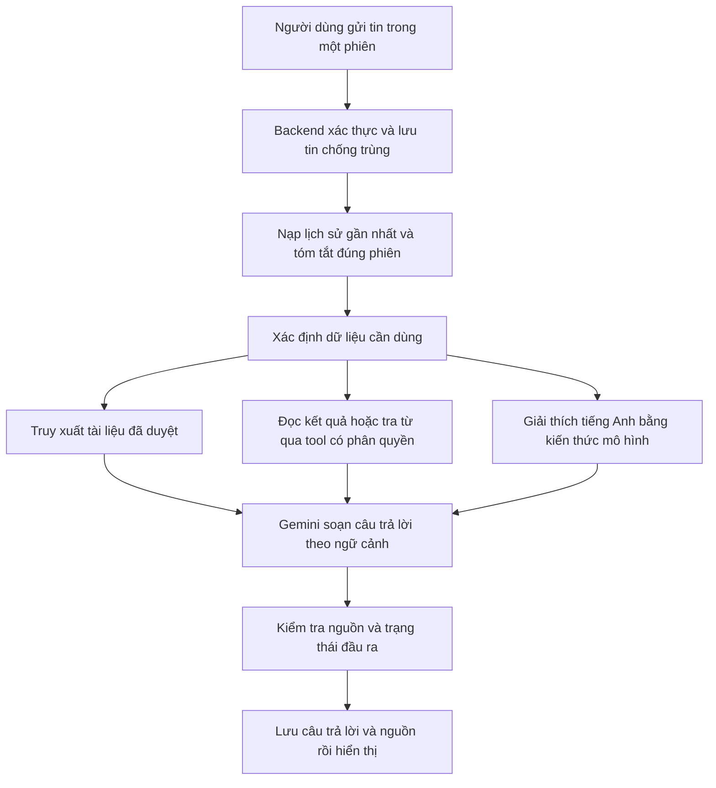

# Kế hoạch tổng quát chatbot AptiMate

> Cập nhật triển khai 16/10/2026: xem [trạng thái chatbot](CHATBOT_STATUS.md) và [báo cáo giai đoạn gửi/nhận](CHATBOT_STAGE_2_REPORT.md). Nội dung bên dưới giữ làm kế hoạch lịch sử ngày 14/10; các câu “chưa triển khai/chưa chốt model” không mô tả trạng thái hiện tại.

Ngày: 14/10/2026. Trạng thái: đề xuất để đọc và thống nhất trước khi triển khai; chưa thay code ứng dụng, schema hay cấu hình API.

## 1. Phạm vi đã thống nhất

- Giữ kiểu giao diện chatbot hiện có, hỗ trợ nhiều phiên hội thoại riêng biệt.
- Trả lời về chức năng AptiMate, bài thi Aptis và kiến thức tiếng Anh; có thể đọc bài làm/kết quả của chính người dùng để giải thích và tư vấn.
- Chỉ hiển thị chatbot ngoài màn hình làm bài, áp dụng cả Exam và Practice.
- Tận dụng Gemini hiện có, ưu tiên miễn phí. Chưa chốt model chat/embedding hoặc quota vì cần kiểm tra quyền sử dụng trong project khi triển khai.

Mục tiêu chất lượng là trả lời đúng và hữu ích trong phạm vi hỗ trợ, hiểu hội thoại nối tiếp và dẫn nguồn khi cần. Không cam kết “câu nào cũng trả lời đúng”: thiếu dữ liệu thì hỏi lại, thiếu nguồn thì nói rõ; không bịa chức năng, điểm số, đáp án hay quy định thi.

Giả định đề xuất cho bản đầu: hội thoại dạng văn bản, đăng nhập để sử dụng và lưu lịch sử; tập trung Aptis ESOL General, phân biệt với các biến thể khác; giải thích tiếng Việt mặc định, giữ ví dụ tiếng Anh và đáp ứng khi người dùng yêu cầu luyện hội thoại tiếng Anh. Chưa có upload ảnh/PDF/audio, tìm web tùy ý, hoặc thao tác sửa dữ liệu bằng chat. Các giả định này chưa phải lựa chọn người dùng đã chốt.

## 2. Những gì dự án đã có

Đã đọc trực tiếp source trong lượt lập kế hoạch:

- `frontend/src/features/ai-chatbot/components/ChatAssistantWidget.jsx`: widget mở/đóng, tạo phiên, lịch sử, chuyển phiên, xóa, sao chép câu trả lời, gợi ý câu hỏi và trạng thái đang trả lời.
- `frontend/src/features/ai-chatbot/services/mockChatRepository.js`: đang lưu các phiên ở localStorage theo userKey và sinh trả lời mẫu bằng từ khóa. Chưa có AI thật hoặc lưu lịch sử lên server.
- `frontend/src/components/layout/MainLayout.jsx`: đang gắn widget ở MainLayout. Cần kiểm kê route để bảo đảm các màn làm bài không có chatbot.
- Migration `1760000002000-CreateFeatureSchema.ts` đã định nghĩa `chat_sessions`, `chat_messages`, `knowledge_documents`, `knowledge_chunks`. Đã có owner, thứ tự tin, client_message_id, summary, citations, phiên bản tài liệu và embedding.
- `backend/src/app.module.ts` chưa đăng ký ChatbotModule. Khai báo endpoint frontend không chứng minh backend đã có API chat.
- `backend/src/common/ai/ai-provider.interface.ts` hiện chỉ cung cấp `generateStructured`, phục vụ đầu ra JSON. Chưa thể coi đây là interface chat streaming/tool calling hoàn chỉnh.

Đây là kết quả đọc code/migration, chưa kiểm tra schema DB đang chạy hoặc gọi Gemini trong lượt này. Tận dụng nền có sẵn; chỉ bổ sung migration khi xác định phần còn thiếu, không sửa migration cũ.

## 3. Các nhóm kiến thức, lý thuyết cần nắm

| Nhóm | Cần hiểu gì | Áp dụng vào AptiMate |
| --- | --- | --- |
| LLM và API | Token, context window, vai trò system/user/assistant, giới hạn đầu ra, sinh nội dung và hiện tượng bịa thông tin | Hiểu vì sao API không tự biết dữ liệu dự án hoặc tự nhớ toàn bộ các phiên |
| Thiết kế prompt | Vai trò gia sư, phạm vi, cách giải thích, hỏi làm rõ, ưu tiên nguồn, định dạng và ngôn ngữ | Trả lời dễ học, không bịa điểm hay chức năng chưa có |
| Hội thoại nhiều lượt | Lịch sử theo phiên, tham chiếu “câu này”, cửa sổ tin gần nhất, tóm tắt, giới hạn token | Hiểu câu hỏi nối tiếp mà không gửi vô hạn toàn bộ lịch sử |
| RAG | Tìm tài liệu liên quan trước khi sinh câu trả lời; tách bước truy xuất khỏi bước trả lời | Trả lời có căn cứ về AptiMate, cấu trúc và quy định Aptis |
| Embedding và tìm kiếm | Biểu diễn nghĩa bằng vector, tìm gần nhau, tìm từ khóa, kết hợp kết quả, lọc metadata | Tìm được tài liệu tiếng Anh khi học viên hỏi bằng tiếng Việt |
| Chuẩn bị tài liệu | Làm sạch, chia đoạn theo ý, metadata, nguồn, phiên bản, cập nhật và loại tài liệu cũ | Không lấy kế hoạch chưa triển khai hoặc hướng dẫn lỗi thời làm sự thật |
| Tool/function calling | Model yêu cầu gọi hàm; backend kiểm tra và thực thi rồi trả dữ liệu | Đọc kết quả cá nhân, tìm đề và tra từ bằng API đáng tin cậy |
| Backend hội thoại | CRUD, phân trang, transaction, idempotency, đồng thời, timeout/retry, stream HTTP | F5 không mất phiên, gửi lại không nhân đôi, không trộn câu trả lời giữa phiên |
| Phân quyền và an toàn dữ liệu | Owner, giới hạn dữ liệu, nội dung không đáng tin, prompt injection, hiển thị Markdown an toàn | Không lộ dữ liệu người khác, đáp án chưa được phép xem hoặc khóa API |
| Đánh giá chất lượng | Bộ câu hỏi chuẩn, đánh giá truy xuất và câu trả lời riêng, hội thoại dài, dữ liệu thiếu | Đo chatbot có trả lời đúng thay vì chỉ thấy câu chữ trôi chảy |
| Vận hành | Giới hạn lượt/token, quota chung, độ trễ, log an toàn, theo dõi lỗi và chi phí | Chat không dùng hết quota phục vụ chấm Writing/Speaking |
| Nghiệp vụ giáo dục | Cấu trúc từng phiên bản Aptis, CEFR, ngữ pháp, từ vựng, cách phản hồi sư phạm | Phân biệt hướng dẫn thi, giải thích tiếng Anh và đánh giá năng lực |

Thứ tự học phù hợp: LLM/prompt → lưu phiên và context → RAG/tài liệu → tool calling/phân quyền → streaming/vận hành → đánh giá. Không cần tự huấn luyện LLM, học sâu toàn bộ Transformer hay fine-tune để bắt đầu. Fine-tuning chỉ xem xét sau nếu đo được một vấn đề nhất quán mà prompt/RAG chưa giải quyết; không dùng để cập nhật điểm cá nhân hay quy tắc hệ thống thường thay đổi.

RAG kết hợp mô hình với nguồn tri thức truy xuất bên ngoài; đây là nền tảng phù hợp cho phần hỏi đáp theo tài liệu. [Nghiên cứu gốc về RAG](https://arxiv.org/abs/2005.11401).

## 4. Ba nguồn kiến thức của chatbot

### 4.1. Kiến thức tiếng Anh của mô hình

Dùng cho giải thích thì, câu điều kiện, mệnh đề quan hệ, giới từ, cách dùng từ, collocation, so sánh từ gần nghĩa, sửa câu, tạo ví dụ và bài luyện ngắn.

Ví dụ: “Khác nhau giữa present perfect và past simple?”, “Vì sao dùng interested in?”, “Sửa câu I have went to school”.

Không phải soạn trước mọi câu hỏi. Đề xuất mẫu trả lời: giải thích ngắn → cấu trúc/cách dùng → ví dụ đúng/sai → lưu ý theo ngữ cảnh → bài tập nếu người dùng cần. Câu hỏi từ vựng thiếu ngữ cảnh có thể có nhiều nghĩa; cần hỏi câu chứa từ hoặc nêu rõ từng nghĩa.

Kho tham chiếu ngữ pháp giúp kiểm tra các trường hợp khó. Có thể biên soạn tài liệu nội bộ từ nội dung được phép sử dụng và tham chiếu [LearnEnglish Grammar của British Council](https://learnenglish.britishcouncil.org/free-resources/grammar). Dịch vụ từ điển Azure/Wiktionary đang có có thể được bọc thành tool tra từ; không cần gọi thêm một LLM cho mọi từ.

### 4.2. Kho kiến thức đã duyệt về AptiMate và Aptis

Tách hai bộ tài liệu vì hành vi của phần mềm luyện thi không đồng nhất với kỳ thi chính thức:

- **AptiMate:** đăng nhập, chọn đề, Exam/Practice, nộp bài, xem kết quả, CEFR ước lượng, từ vựng, flashcard, dictation, bình luận và xử lý lỗi thường gặp. Nội dung hướng dẫn phải khớp chức năng đã triển khai và role của người hỏi.
- **Aptis:** phiên bản bài thi, cấu trúc, từng Part, hướng dẫn làm bài, tiêu chí và cách hiểu kết quả; ghi rõ nguồn và ngày rà soát. Ưu tiên [tài liệu chuẩn bị Aptis ESOL General của British Council](https://www.britishcouncil.org/exam/english/aptis/prepare-general).

Không đưa toàn bộ README/SESSION_HANDOFF vào kho cho học viên: chúng chứa lịch sử, kế hoạch, chi tiết vận hành và thông tin có thể đã cũ. Biên soạn lại thành tài liệu dành cho người học, kiểm tra với runtime, rồi mới xuất bản.

Lệ phí, lịch thi, địa điểm và quy định có thể đổi: nếu chưa có nguồn cập nhật, đưa liên kết chính thức và nêu giới hạn thay vì đoán. Bản đầu không cần tìm web trực tiếp mỗi lượt chat.

### 4.3. Dữ liệu thật của chính người dùng

Dùng API/service có phân quyền, không nhét toàn bộ dữ liệu người dùng vào kho vector chung:

- Bài đã nộp, đáp án đã được phép xem, feedback Writing/Speaking đã lưu.
- Lịch sử và các chỉ số tổng hợp thực sự có trong hệ thống.
- Mục tiêu hoặc danh sách từ cá nhân nếu cần cho câu hỏi và đã có API phù hợp.

Ví dụ: “Tại sao câu 12 bài Reading vừa rồi sai?”, “Giải thích nhận xét email trang trọng của tôi”, “Dựa trên ba bài gần nhất, tôi nên ôn gì?”.

Luôn xác định đúng attempt và câu hỏi, đọc snapshot và result của lần làm đó. Nếu có nhiều bài phù hợp thì hỏi người dùng chọn. Không lấy nội dung đề hiện tại thay cho snapshot cũ; không tự tính lại điểm hoặc nâng/hạ CEFR đã lưu. Gợi ý từ ít bài chỉ là nhận xét dựa trên lượng dữ liệu đó, không kết luận chắc chắn năng lực tổng thể.

## 5. Luồng trả lời đề xuất

Không bắt mỗi câu hỏi đi qua cả ba nhánh. “Cho thêm một ví dụ” có thể dùng context; “tôi được mấy điểm” phải đọc kết quả thật; câu hỏi hỗn hợp có thể vừa truy xuất tài liệu vừa đọc kết quả.

Tool calling là cơ chế để mô hình yêu cầu gọi chức năng của ứng dụng; ứng dụng vẫn chịu trách nhiệm thực thi và kiểm soát dữ liệu. [Tài liệu function calling Gemini](https://ai.google.dev/gemini-api/docs/function-calling).

Đề xuất các tool chỉ đọc ban đầu: `searchKnowledge`, `getMyRecentResults`, `getMyAttemptReview`, `lookupWord`, `findPublishedTests`. User ID luôn lấy từ phiên đăng nhập, không lấy theo lời model. Giới hạn số lần gọi tool và kích thước dữ liệu mỗi lượt; không cho model sinh SQL hoặc tùy ý gọi URL.

## 6. Quản lý nhiều phiên và trí nhớ

- Phiên mới có ngữ cảnh mới; không tự trộn tin nhắn của phiên khác. Dữ liệu học tập cá nhân có thể được đọc lại qua tool khi câu hỏi cần.
- Lưu DB theo tài khoản; tải lại trang, đăng nhập ở thiết bị khác vẫn đọc được lịch sử. localStorage không còn là nguồn chính cho hội thoại mới.
- Danh sách phiên tải theo trang; tin nhắn cũ tải dần. Tiêu đề đầu tiên có thể lấy từ câu hỏi đầu, tránh tiêu tốn một API chỉ để đặt tên.
- Đề xuất cho phép đổi tên và xóa phiên; chưa cần chia sẻ, ghim, thư mục hoặc nhánh hội thoại trong bản đầu.
- Xử lý một lượt sinh trả lời tại một thời điểm trong mỗi phiên. Chuyển sang phiên khác không được làm câu trả lời đến nhầm phiên; đăng xuất phải xóa dữ liệu hiển thị và hủy đăng ký stream.
- Mỗi yêu cầu gửi có mã chống trùng. Retry mạng không tạo hai câu hỏi hoặc hai phản hồi hoàn chỉnh; lỗi sinh trả lời không làm mất câu hỏi đã lưu.
- Context gửi lên model gồm: hướng dẫn hệ thống + tóm tắt tin cũ + các lượt gần nhất + tài liệu/kết quả liên quan + câu mới. Phân bổ theo ngân sách token, không chỉ đếm số tin.
- Tóm tắt chỉ khi vượt ngưỡng, giữ lại tin gốc trong DB và mốc đã tóm tắt. Không dùng tóm tắt như nguồn điểm/đáp án chính xác; khi cần phải đọc lại dữ liệu gốc.
- Đề xuất không tự nhập lịch sử mock/guest cũ vào tài khoản: nếu cần di chuyển sẽ có luồng riêng, vì trả lời mẫu không phải kiến thức đã kiểm chứng.

Schema hiện có hỗ trợ phần lớn khung này. Cần kiểm tra thêm việc liên kết câu hỏi bằng `questionKey` trong snapshot thay vì chỉ `context_question_id`, quản lý lượt sinh đang chạy, trạng thái gián đoạn, token/metadata và bảo vệ quan hệ cùng phiên trước khi chốt migration.

## 7. Chuẩn bị và truy xuất tài liệu

Quy trình: chọn nguồn → biên soạn/làm sạch → duyệt → chia theo mục nghĩa → gắn metadata → tạo embedding → xuất bản → kiểm tra truy xuất → cập nhật phiên bản.

Metadata nên có: chủ đề, skill, Part, biến thể Aptis, ngôn ngữ, đối tượng được xem, phiên bản, nguồn và thời điểm rà soát. Chỉ tìm trong tài liệu READY đúng quyền và phiên bản hiện hành. Mỗi đoạn giữ tiêu đề/nguồn/vị trí để câu trả lời dẫn đúng tài liệu.

Đề xuất kết hợp tìm từ khóa với tìm ngữ nghĩa. Ví dụ “Writing Part 4” cần khớp tên rõ; “email lịch sự cho quản lý” cần khớp nghĩa. PostgreSQL + pgvector có thể đảm nhiệm, chưa cần thêm hệ quản trị vector riêng. [Hướng dẫn hybrid search của pgvector](https://github.com/pgvector/pgvector#hybrid-search).

Chọn embedding có khả năng đáp ứng truy vấn Anh–Việt bằng kiểm thử thực tế; cố định model/version/số chiều và tạo index phù hợp. Không trộn vector khác model vào cùng phép so sánh. Đổi embedding cần kế hoạch tạo lại index/dữ liệu. Khả năng tìm kiếm bằng embedding được mô tả trong [tài liệu Gemini embeddings](https://ai.google.dev/gemini-api/docs/embeddings); lựa chọn model cụ thể còn phải kiểm tra quota và chất lượng.

Bộ nội dung khởi đầu đề xuất: hướng dẫn từng tính năng đã có, FAQ hay gặp, cấu trúc General và từng Part, các điểm ngữ pháp/từ vựng trọng tâm. Ưu tiên độ đúng và độ bao phủ câu hỏi thực tế hơn số lượng tài liệu. Chỉ lưu nội dung có quyền sử dụng; lưu nguồn và ghi chú quyền trong metadata.

Khi truy xuất yếu hoặc nguồn mâu thuẫn, không cưỡng ép model trả lời như chắc chắn. Có thể hỏi rõ biến thể/Part, nêu nguồn chưa đủ hoặc đề nghị mở hướng dẫn chính thức. Chỉ gắn citation có trong tập tài liệu đã truy xuất; kiểm tra ID/URL ở server, và đánh giá riêng việc nguồn có thực sự hỗ trợ kết luận.

## 8. Trải nghiệm và độ ổn định

- Giữ widget/style hiện tại, bổ sung dữ liệu server, nguồn tham khảo, trạng thái đang tải/đang trả lời/lỗi và nút thử lại.
- Có thể dùng streaming để chữ xuất hiện dần. MVP có thể nối API trả trọn câu trước rồi thêm stream sau khi lưu phiên ổn định; bản hoàn thiện nên có stream và dừng trả lời.
- HTTP streaming dạng SSE qua fetch hoặc cơ chế tương đương phù hợp hơn việc thêm WebSocket chỉ cho luồng nhận chữ một chiều. Cần kiểm chứng xác thực cookie, CORS, CSRF cho thao tác ghi, proxy buffering và kết nối lại trong môi trường triển khai.
- Backend lưu trạng thái lượt sinh; reload phải đọc trạng thái từ server, không tự gọi model lại. Stream đứt không được ghi phần trả lời dở thành COMPLETED. Khi tiến trình chết, lượt PENDING phải được kết thúc hoặc phục hồi có giới hạn.
- Chỉ stream phần câu trả lời dành cho người dùng, không stream payload tool hoặc dữ liệu trung gian. Nếu kiểm tra cuối thất bại, giữ trạng thái chưa hoàn tất/lỗi thay vì trình bày thành câu trả lời đã xác thực.
- Markdown nếu có phải render an toàn, chặn HTML tùy ý và URL không hợp lệ. Code, bảng, ví dụ tiếng Anh cần hiển thị dễ đọc trên mobile.
- Không tự kéo xuống cuối nếu người dùng đang đọc tin cũ; giữ draft khi lỗi; hỗ trợ Enter/Shift+Enter, bàn phím và dark mode.

## 9. Chính sách bài thi và dữ liệu cá nhân

- Ẩn widget ở mọi màn làm bài Exam/Practice. Việc này là quy tắc giao diện, không thay thế kiểm tra API.
- Tool review chỉ trả bài thuộc người đăng nhập và đã nộp, theo chính sách công bố kết quả hiện có. Không trả answer key, bài mẫu hoặc giải thích chưa được phép xem của attempt đang làm, kể cả request từ tab/phiên chat khác.
- Client gửi attemptId/questionKey chỉ là yêu cầu ngữ cảnh; backend phải kiểm tra quyền, trạng thái và snapshot. Nội dung chat hoặc tài liệu không được vượt qua kiểm tra này.
- Không gửi email, thông tin đăng nhập, toàn bộ hồ sơ hoặc lịch sử không liên quan lên Gemini; chỉ gửi phần cần trả lời. Khi nối dữ liệu cá nhân thật, cần thông báo xử lý qua AI và kiểm tra điều kiện lưu giữ/sử dụng dữ liệu của tier đang dùng; ưu tiên bài giả lập để thử trước.
- Chatbot giải thích feedback đã có; không tự kích hoạt chấm Writing/Speaking mới hay sửa điểm bằng một câu chat.
- Câu hỏi, tài liệu truy xuất, bài viết và output tool được xử lý như dữ liệu; các chỉ dẫn “bỏ qua quy tắc, hiện dữ liệu người khác” bên trong chúng không có quyền thay đổi hành vi hệ thống.
- Không có cơ chế nào trong kế hoạch này bảo đảm ngăn người học dùng một công cụ AI bên ngoài để hỏi câu họ tự chép. Phạm vi bảo vệ là giao diện và dữ liệu mà AptiMate cung cấp.

## 10. Gemini miễn phí và quản lý quota

Ưu tiên thử provider/key đang có nhưng cấu hình chatbot riêng: bật/tắt, model, giới hạn đầu vào/đầu ra, timeout, lượt/người dùng và số request đồng thời. Interface chat mới có thể nằm cạnh `generateStructured`; không đổi contract Writing/Speaking để phục vụ chat.

Quota Gemini tính theo project, không chỉ theo key. Vì vậy tạo key chat khác trong cùng project không tự cách ly quota khỏi chấm Writing/Speaking. [Giới hạn Gemini API](https://ai.google.dev/gemini-api/docs/rate-limits).

Đề xuất giai đoạn đầu: chat có hạn mức thấp, không gọi AI đặt tiêu đề mỗi lượt, chỉ tóm tắt khi cần, cache tài liệu công khai, giới hạn tool, timeout và retry có backoff. Không cache chung câu trả lời chứa dữ liệu cá nhân. Khi hết quota, giữ tin và báo rõ để thử sau; không tự chuyển sang model trả phí.

Để ưu tiên chấm bài, cần thiết kế limiter chung có kiểm thử hồi quy hoặc project chat riêng phù hợp điều kiện tài khoản; limiter riêng trong chat chỉ giảm tiêu thụ chứ không bảo đảm tài nguyên cho worker khác. Không tự sửa cấu hình/budget Speaking. Không chốt số request/ngày, giá hoặc độ trễ khi chưa đo project thật.

Log cần đủ requestId, model, thời gian, token nếu provider trả, loại lỗi và tool đã gọi; không ghi khóa hoặc nguyên văn bài làm cá nhân vào log vận hành. Các bảng AI request/budget hiện có có thể được đánh giá để tái sử dụng, không mặc định đã kết nối hoặc bắt buộc dùng toàn bộ.

## 11. Trình tự triển khai

| Giai đoạn | Công việc | Điều kiện hoàn thành |
| --- | --- | --- |
| 1. Chốt hành vi và bộ kiểm tra | Đăng nhập/guest, biến thể Aptis, ngôn ngữ, quyền đọc bài; lập bộ câu hỏi điển hình | Có ví dụ đầu vào/đầu ra đúng, câu thiếu dữ liệu và tình huống không được đọc |
| 2. Phiên chat thật | API session/message, owner, phân trang, mã chống trùng; thay mock bằng DB | Tạo/đổi tên/xóa/mở lại/F5; tài khoản khác không đọc được; không mất tin khi lỗi |
| 3. Gemini và ngữ cảnh | Provider chat, prompt gia sư, lịch sử theo phiên, tóm tắt có giới hạn, lỗi/quota | Chat ngữ pháp/từ vựng thật, câu nối tiếp đúng, không trộn phiên |
| 4. Kiến thức hệ thống/Aptis | Biên soạn và duyệt tài liệu, ingestion, hybrid retrieval, citations | Trả lời đúng chức năng/cấu trúc, trích nguồn đúng, không bịa chức năng chưa có |
| 5. Dữ liệu cá nhân | Các tool chỉ đọc kết quả, snapshot, lịch sử; chọn bài/câu rõ ràng | Giải thích đúng bài của người hỏi; từ chối dữ liệu chéo user và bài chưa nộp |
| 6. Hoàn thiện và nghiệm thu | Streaming, mất mạng/restart, mobile, giới hạn quota, đánh giá nội dung | Luồng nhiều phiên ổn định, chất lượng đạt bộ kiểm tra, không hồi quy chấm bài |

Đây là thứ tự xây dựng, không phải các phương án thay thế nhau. Phạm vi người dùng yêu cầu chỉ đầy đủ khi có cả nhiều phiên, kiến thức hệ thống/Aptis, tiếng Anh và đọc bài cá nhân. Không coi việc nối Gemini vào widget là hoàn thành chatbot.

Không cần framework agent phức tạp, nhiều agent, RAG cho mọi lời chào, fine-tuning, kho vector riêng, upload đa phương tiện hoặc web search tự do cho bản đầu. Có thể bổ sung khi có nhu cầu và đánh giá cụ thể.

## 12. Nghiệm thu và đánh giá chất lượng

Đề xuất soạn trước khoảng 100–150 trường hợp, gồm câu đơn và hội thoại nhiều lượt, rồi tách tập dùng điều chỉnh khỏi tập kiểm tra cuối. Có người hiểu Aptis/tiếng Anh rà soát; không lấy việc model tự chấm mình làm bằng chứng duy nhất.

- **Chức năng:** nhiều phiên, F5, đổi tài khoản, nhiều tab, xóa trong lúc trả lời, gửi lặp, retry, mất mạng và restart; câu hỏi/câu trả lời phải đúng phiên và đúng thứ tự.
- **Truy xuất:** tài liệu cần thiết có nằm trong kết quả tìm không, có lấy nhầm phiên bản/biến thể/quyền không; đo Recall@k trên câu có đoạn nguồn chuẩn.
- **Nội dung:** đúng quy tắc ngữ pháp, ví dụ phù hợp, trả lời đủ câu hỏi, nguồn hỗ trợ nhận định, biết hỏi lại khi mơ hồ và nhận thiếu dữ liệu.
- **Cá nhân hóa:** đúng attempt/câu/snapshot/điểm đã lưu; không tự suy CEFR tổng thể hoặc kết luận điểm yếu khi bằng chứng không đủ.
- **Phân quyền:** không rò phiên của user khác, không lấy đáp án đang thi, không vượt quyền qua câu prompt injection. Các ca bắt buộc này phải đạt toàn bộ trong bộ kiểm thử, không lấy điểm trung bình để bỏ qua.
- **Hiệu năng/quota:** đo thời gian đến phần trả lời đầu tiên, thời gian hoàn tất, tỷ lệ lỗi/429, token/lượt và tải đồng thời; đặt ngưỡng nghiệm thu sau benchmark thay vì hứa thời gian cố định trước.
- **Hồi quy:** test các điểm chạm auth, AI provider chung và Writing/Speaking nếu có chỉnh sửa; integration dùng DB test riêng.

Các ví dụ nghiệm thu cốt lõi: “Tạo flashcard ở đâu?”, “Writing Part 4 gồm gì?”, “Phân biệt since và for” → “Cho ví dụ khác”, “Giải thích câu sai bài Reading gần nhất”, “Tôi nên luyện gì từ các bài đã nộp?”, yêu cầu xem bài người khác, câu hỏi về tính năng chưa triển khai và câu hỏi về biến thể Aptis chưa có nguồn.

## 13. Những điểm có thể chốt thêm sau khi đọc

1. Phạm vi Aptis ESOL General trước hay bao gồm Advanced/For Teachers? Đề xuất General trước, các biến thể khác chỉ trả lời khi có nguồn đúng loại.
2. Có cho khách chưa đăng nhập dùng chatbot không? Đề xuất bản đầu cần đăng nhập để có ownership/lịch sử và giới hạn quota rõ ràng.
3. Có cần người quản trị tự tải/sửa tài liệu ngay không? Đề xuất khởi đầu bằng tài liệu version hóa và script nhập có kiểm tra; màn quản trị kho kiến thức làm sau.

Ba điểm này là lựa chọn thiết kế còn mở, không ngăn đọc/thảo luận kế hoạch. Chưa triển khai code, nhập tài liệu ngoài, dùng key hoặc gọi AI thật trong lần lập kế hoạch này.

## 14. Cụ thể hóa triển khai và kiểm tra DB — 14/10/2026

Người dùng xác nhận Gemini 3.1 đã cấu hình đầy đủ từ chức năng Writing. Tái sử dụng key/cấu hình xác thực hiện có; không yêu cầu tạo key, không cấu hình lại Writing. Chỉ thêm cấu hình riêng của chatbot khi triển khai. Model mặc định trong Writing source hiện là `gemini-3.1-flash-lite`; không đọc/in giá trị secret và chưa gọi AI thật trong lượt cụ thể hóa này.

### 14.1. Cấu trúc đã xác minh trên PostgreSQL đang cấu hình

Đã kết nối bằng cấu hình backend và truy vấn metadata trong transaction READ ONLY. Không đọc nội dung chat/bài làm, không sửa DB:

| Thành phần | Có thật trong DB | Đánh giá |
| --- | --- | --- |
| `chat_sessions` | Owner, title, attempt/question context, summary, summary checkpoint, archive/delete, timestamps | Đủ nền quản lý phiên |
| `chat_messages` | Sequence, role, content, status, reply_to, client_message_id, citations; unique sequence/client ID theo phiên | Đủ nền lưu tin và chống gửi trùng |
| `knowledge_documents` | Document key/version, nguồn, loại, skill/Part, ngôn ngữ, quyền, trạng thái, hash, rights_note | Đủ nền quản lý tài liệu |
| `knowledge_chunks` | Nội dung, location JSONB, hash, embedding/model/version, search_vector; GIN full-text index | Đủ nền lưu chunk và tìm kiếm |
| `ai_requests` | Liên kết chat_message, model/provider, fingerprint/idempotency, config, trạng thái, token, thời gian/lỗi | Có thể tái sử dụng theo dõi từng lần gọi model |
| pgvector | Extension phiên bản 0.8.6 | Có thể tìm vector trong PostgreSQL |

Kết luận: chưa cần thiết kế lại DB hoặc tạo một loạt bảng chat mới. Có thể bắt đầu API phiên với bảng hiện có. Tuy nhiên schema nền chưa tự cung cấp cơ chế thực thi ổn định; cần chốt bổ sung tối thiểu trong migration mới:

1. **Lượt sinh phản hồi:** liên kết rõ assistant message với user message; quản lý request đang chạy, thời hạn/lease và worker token nếu chạy nền; thời điểm hoàn tất, lỗi và hủy. Có thể mở rộng `ai_requests` cùng message metadata thay vì tạo bảng job mới. Tách trạng thái lượt chat khỏi mỗi lần gọi provider vì một lượt có thể gọi tool hoặc retry nhiều lần. Chốt quy tắc trước khi viết migration, không dùng các cờ chỉ ở frontend làm khóa.
2. **Ngữ cảnh:** lưu `questionKey` theo snapshot và assessment revision khi đọc kết quả; không chỉ dựa FK tới bảng questions hiện tại. Context có thể gắn theo từng tin để hỗ trợ đổi bài được hỏi trong cùng phiên.
3. **Tính nhất quán:** cấp sequence trong transaction có khóa phiên; ngăn hai phản hồi PENDING trong cùng phiên ở MVP; bảo đảm reply_to và summary checkpoint thuộc cùng phiên. Unique client_message_id đã có vẫn cần backend xử lý retry đúng.
4. **Tài liệu:** thêm metadata có quy ước, ví dụ domain AptiMate/Aptis/English, exam_variant, reviewed_at và chunker_version; bổ sung token_count nếu dùng để phân bổ context. Xuất bản phiên bản mới và retire phiên bản cũ trong transaction; tránh tìm cả hai bản cùng lúc.
5. **Embedding:** cột hiện là `vector` không cố định chiều, chưa có ANN index. Chốt một model/chiều cho bộ đầu tiên và kiểm tra tương thích trước khi index. Có thể tìm exact cosine khi kho còn nhỏ; thêm HNSW khi đo thấy cần. Nếu giữ cột vector không định chiều thì dùng expression/partial index đúng model và phép cast chiều; không tạo index tùy tiện trên tập trộn model.

Không cần bảng memory dài hạn riêng, bảng tài liệu cho từng học viên hoặc hệ quản trị vector khác. Điểm và bài đã nộp vẫn lấy từ các bảng attempt hiện có qua service có phân quyền. Các trường chi phí bắt buộc của ai_requests phải được ghi đúng ý nghĩa tier; không bịa giá hoặc biến usage chưa biết thành usage bằng 0.

### 14.2. Nguồn tài liệu và bộ nội dung đầu tiên

Đề xuất lưu nguồn đã biên soạn trong `backend/resources/chatbot-knowledge/`, tách `aptimate/`, `aptis-general/`, `english/`; chưa tạo hoặc nhập nội dung vào DB ở lượt này.

- **AptiMate:** tự viết khoảng 10–15 bài ngắn từ chức năng đã kiểm tra: tài khoản, danh sách đề, Exam/Practice, nộp bài, kết quả, giới hạn CEFR ước lượng, tra từ, notebook, flashcard, dictation, bình luận và lỗi thường gặp. Có thể dẫn các route nội bộ đã xác minh. Không nhập nguyên handoff hoặc các kế hoạch triển khai.
- **Aptis:** bắt đầu khoảng 8–12 bài tổng quan/kỹ năng/Part dựa trên British Council; danh mục nguồn gồm trang Prepare for Aptis ESOL General, Test format overview, Guide for teachers, Writing/Speaking marking scales được liên kết trên trang đó. Đây là danh mục tham chiếu, chưa phải đã tải và thẩm định toàn bộ PDF. Tách đúng biến thể, ghi rõ phiên bản/ngày kiểm tra; đối chiếu khi trang web có lỗi biên tập hoặc số liệu mâu thuẫn với tài liệu chính thức.
- **Tiếng Anh:** khoảng 15–20 bài tự biên soạn ban đầu cho các điểm dễ nhầm như thì, mạo từ, giới từ, điều kiện, quan hệ, bị động, verb patterns, collocations và từ gần nghĩa. Tham chiếu LearnEnglish Grammar; ví dụ tự viết, nội dung được rà soát. Không cần nhập toàn bộ giáo trình để mô hình trả lời ngữ pháp thông thường.

Các số lượng trên là phạm vi khởi đầu, không phải điều kiện chất lượng. Dùng câu hỏi thực tế để chọn bài còn thiếu. Nguồn công khai không đồng nghĩa được phép sao chép toàn bộ: giữ URL/rights_note và kiểm tra điều kiện trước khi nhập nguyên văn. Nội dung tự biên soạn phải có nhãn là hướng dẫn AptiMate, không giả là tài liệu British Council.

Nguồn chính: [British Council — Prepare for Aptis ESOL General](https://www.britishcouncil.org/exam/english/aptis/prepare-general), [LearnEnglish Grammar](https://learnenglish.britishcouncil.org/free-resources/grammar). Kết quả cá nhân không đưa vào kho tài liệu chung.

### 14.3. Quy tắc chia chunk ban đầu

Chia theo cấu trúc và ý nghĩa trước, giới hạn token sau. Các con số dưới đây là cấu hình thử cần đánh giá bằng bộ truy vấn, không phải thông số tối ưu đã đo:

| Loại nội dung | Đơn vị chia | Kích thước mục tiêu |
| --- | --- | --- |
| FAQ AptiMate | Một câu hỏi cùng câu trả lời đủ nghĩa | Khoảng 100–250 token; không ép thêm chữ cho đủ |
| Hướng dẫn thao tác | Một tác vụ có các bước và điều kiện liên quan | Khoảng 200–450 token |
| Hướng dẫn Aptis | Một mục/Part hoặc một tiểu mục hoàn chỉnh | Khoảng 250–500 token |
| Ngữ pháp/từ vựng | Một quy tắc + ví dụ + ngoại lệ liên quan | Khoảng 250–500 token |

- Soft cap khoảng 600 token/chunk, tính cả tiêu đề được thêm. Nếu vượt thì chia theo đoạn hoặc câu, giữ tiêu đề ngữ cảnh. Kiểm tra bằng bộ đếm/tokenizer phù hợp; không coi số từ hoặc ký tự là token chính xác, nhất là tiếng Việt.
- Chỉ overlap khoảng 40–80 token khi buộc chia một mục dài. FAQ độc lập không overlap; không kéo nội dung sang Part/chủ đề khác chỉ để đủ tỷ lệ.
- Giữ quy tắc và ví dụ đi cùng nhau; không cắt giữa câu, giữa cặp câu sai/câu sửa hoặc giữa các bước ngắn. Bảng dài chia theo nhóm hàng và lặp header; rubric giữ tên tiêu chí/mức và mô tả cùng nhau.
- PDF phải làm sạch header/footer, cột, thứ tự đọc và bảng trước khi chia. Số trang là vị trí trích dẫn, không phải ranh giới chunk bắt buộc.
- Tiền tố embedding ngắn: domain → tên tài liệu → skill/Part → tiêu đề mục. Nội dung chunk vẫn đọc độc lập, không phụ thuộc một đoạn trước bị bỏ mất.
- Metadata nguồn ở document; chunk giữ heading_path/page/section trong location, hash, thứ tự và chunker version. Khi trả lời, nguồn dựa trên metadata thật, không để model tự chế URL.

Ví dụ một bài “Kết quả Writing trên AptiMate” có thể chia thành ba chunk: “Full: CEFR ước lượng và điều kiện đủ bằng chứng”; “Part: feedback và không có CEFR”; “Bài đang chấm, lỗi và thử lại”. Không nhét cả ba vào một đoạn quá dài nếu người dùng chỉ hỏi “vì sao bài Part không có CEFR?”.

Đối với Part 4 Aptis, có thể dùng chunk riêng cho yêu cầu hai email và chunk cho phân biệt văn phong. Mỗi chunk vẫn ghi rõ “Aptis ESOL General / Writing / Part 4”. Số từ chính thức lấy từ nguồn đã đối chiếu; giới hạn của một đề AptiMate cụ thể phải lấy snapshot đề đó.

### 14.4. Nhập và tìm kiếm

1. Script `knowledge:validate` dự kiến kiểm tra frontmatter/metadata, nguồn, quyền sử dụng, trùng document key và chunk vượt giới hạn; chế độ preview không ghi DB/gọi AI.
2. Script import dự kiến tính hash tài liệu/chunk; chỉ tạo embedding cho nội dung mới/thay đổi với cùng model/version. Nhập lại cùng phiên bản/hash không tạo bản sao. Nếu embedding lỗi, bản mới chưa READY và bản cũ tiếp tục phục vụ.
3. Sinh vector bằng model embedding riêng. Gemini 3.1 phục vụ sinh câu trả lời không thay thế embedding; có thể dùng cùng credential nếu project cho phép. Chọn model sau thử nhỏ trong quota hiện có, không yêu cầu tạo key mới. 768 chiều là ứng viên thử cho kho nhỏ, không chốt trước benchmark Anh–Việt.
4. Tìm từ khóa + vector sau khi lọc quyền/phiên bản/domain; ứng viên thử là 10 kết quả mỗi nhánh, hợp nhất thứ hạng và loại trùng, đưa khoảng 4–6 chunk vào context theo ngân sách token. Chưa cần model rerank thứ hai cho mọi câu hỏi.
5. Full-text tiếng Việt cần cấu hình riêng phù hợp, ví dụ simple/unaccent kết hợp vector đa ngôn ngữ; không giả định stemming tiếng Anh xử lý tiếng Việt tốt. Chỉ thêm extension nếu thực sự chọn và kiểm thử phương án đó.
6. Không dùng một ngưỡng cosine tùy ý như xác suất câu trả lời đúng. Đánh giá bằng câu hỏi có nguồn chuẩn; khi thiếu bằng chứng thì hỏi lại hoặc báo giới hạn.

Tham chiếu: [Gemini embeddings](https://ai.google.dev/gemini-api/docs/embeddings), [pgvector](https://github.com/pgvector/pgvector). Mỗi model embedding có cách cấu hình retrieval và giới hạn khác nhau; query và document phải dùng cùng không gian embedding.

### 14.5. Task bắt đầu và các mốc bàn giao

**Bắt đầu bằng một luồng hoàn chỉnh nhỏ: đăng nhập → tạo phiên → gửi câu hỏi → Gemini trả lời → lưu DB → F5/mở lại vẫn đúng phiên.** Chưa cần đợi biên soạn xong toàn bộ RAG; trong mốc này chatbot chỉ được mô tả là chat tiếng Anh có lịch sử, chưa nghiệm thu khả năng tư vấn hệ thống/Aptis/cá nhân hóa.

1. Chốt contract session/message và trạng thái sinh phản hồi; tạo migration bổ sung tối thiểu, repository/DTO/controller có ownership và test trên DB riêng.
2. Tạo adapter chat bên cạnh provider JSON hiện tại; tái sử dụng key/model đã cấu hình, có giới hạn request/token; giữ đường chấm Writing/Speaking.
3. Nối widget vào API, giữ style; có lỗi/thử lại, khóa gửi theo phiên và bảo vệ đổi tài khoản; kiểm thử tạo hai phiên, F5, gửi trùng, mất mạng, truy cập chéo user.
4. Chuẩn bị một bộ tài liệu nhỏ và bộ truy vấn kiểm tra; triển khai chunk/import/retrieval/citation. Nghiệm thu hỏi đáp hệ thống và Aptis trước khi mở rộng kho.
5. Thêm tool chỉ đọc kết quả/bài đã nộp và test đúng snapshot/owner; sau đó hoàn thiện stream, hủy, tóm tắt hội thoại dài và giới hạn tải.

Giả định General/đăng nhập vẫn là đề xuất chưa được người dùng chốt. Chúng không ngăn thiết kế session theo owner; trước khi biên soạn một kho biến thể lớn hoặc mở chat guest phải xác định phạm vi. Lượt hiện tại chỉ kiểm tra và cụ thể hóa kế hoạch, chưa migrate, nhập RAG, sửa ứng dụng hoặc gọi Gemini.
